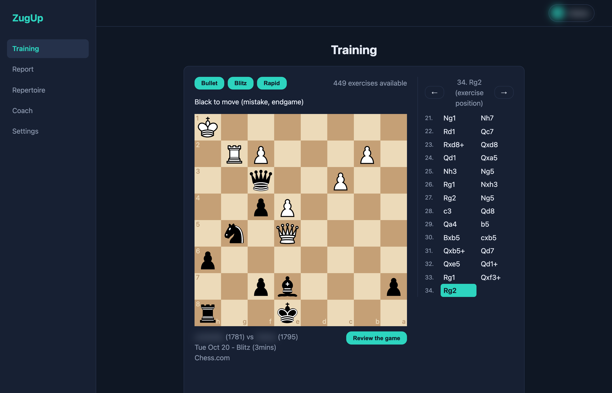
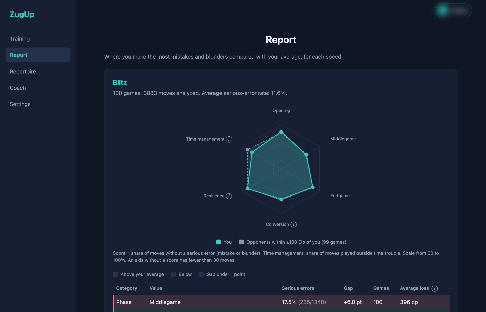
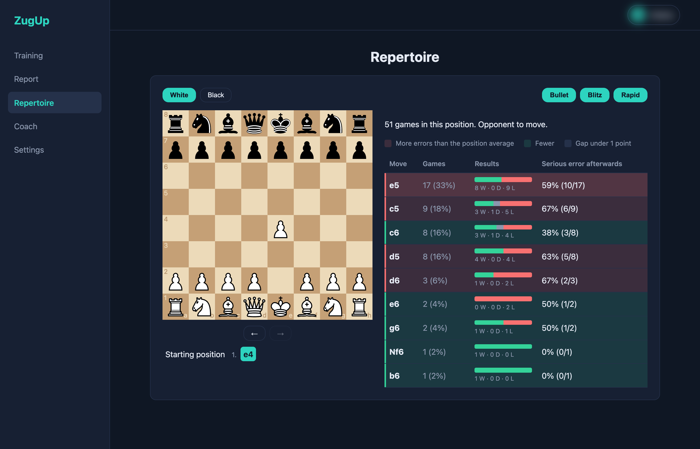
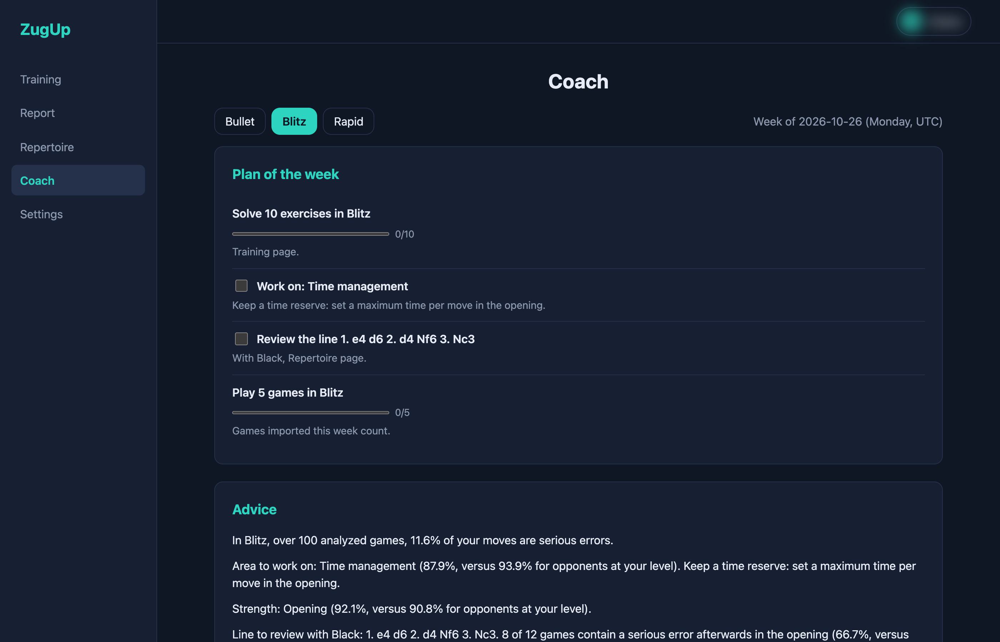
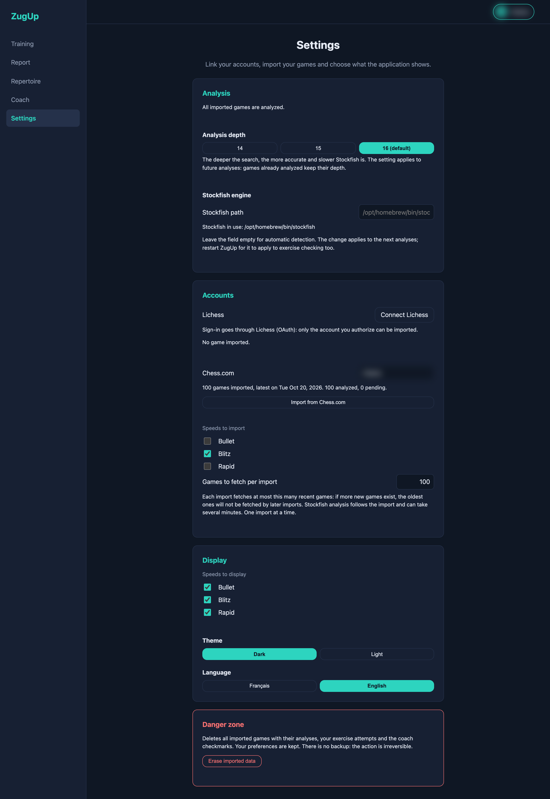

# ZugUp

A local, free chess-improvement tool. It imports your own games from Lichess and Chess.com, analyzes them with Stockfish, finds the mistakes you repeat, and turns them into training exercises, an opening repertoire and a weekly plan.

Everything runs on your machine: games, analyses and settings stay in a local SQLite database. There is no central server and no language model; the coach is rule-based and only formats statistics that Stockfish has already computed.

> Status: personal project in active development, not a finished product.

## Features

- **Import** from Lichess (OAuth sign-in) and Chess.com (public API), with a per-import game limit and a bullet / blitz / rapid selection.
- **Analysis** of every move with Stockfish (depth 14, 15 or 16), run in parallel and resumed automatically if the app was stopped mid-way.
- **Training**: puzzles built from your own mistakes, with attempt tracking. A move is accepted if it is the reference move or one Stockfish judges equivalent.
- **Report**: a radar and tables of your recurring weaknesses per speed, compared with opponents rated within 100 points of you.
- **Repertoire**: an opening tree built from the games you actually played.
- **Coach**: a weekly plan generated from your statistics.
- **Settings page**: connect accounts, import and analyze with a progress bar, choose analysis depth, displayed speeds, a light or dark theme and the language (French or English), or erase all imported data.

## Screenshots

| Training | Report |
|---|---|
|  |  |

| Repertoire | Coach |
|---|---|
|  |  |



## Requirements

- Python 3.11 or later
- [Stockfish](https://stockfishchess.org/) installed locally

## Getting started

```
python -m venv .venv
.venv/bin/pip install -e .[dev]
```

```
./zugup          # web app at http://127.0.0.1:8765
./zugup --dev    # same, restarting on code changes
```

There is no configuration file. ZugUp finds Stockfish by itself (the `ZUGUP_STOCKFISH` environment variable, then your `PATH`, then the usual install folders). If it cannot, enter the path in **Settings**. Games and settings are stored in `data/zugup.db`.

Open **Settings**, click **Connect Lichess** (or type your Chess.com username), then import. The first analysis can take several minutes.

To run the tests: `.venv/bin/python -m pytest`.

## Privacy and security

- The server listens on `127.0.0.1` only.
- `data/` is git-ignored. The Lichess OAuth token is stored in plain text in the local database: do not share the `data/` folder.
- Do not commit tokens or credentials.

## Standalone build

`tools/build_standalone.py --stockfish <binary>` builds a double-click application for the operating system it runs on, using PyInstaller (`pip install -e .[build]`). Only macOS on Apple silicon has been tested. Windows is untested, and PyInstaller cannot cross-compile. The application is unsigned, so the operating system shows a warning at first launch.

## Third-party components

- [Stockfish](https://stockfishchess.org/), the engine, is licensed under the GPL v3. Its license text, authors and source link are kept in `third_party/stockfish/` and copied into standalone builds. If you redistribute a build, you must comply with that license.
- [python-chess](https://github.com/niklasf/python-chess) handles chess logic and engine communication.
- [cm-chessboard](https://github.com/shaack/cm-chessboard) (MIT) draws the board; see its `LICENSE` and `NOTICE.md` under `src/zugup/web/static/vendor/`.
- The chess pieces are by Cburnett and Rfc1394 (Wikimedia Commons), modified by Stefan Haack, licensed [CC BY-SA 3.0](https://creativecommons.org/licenses/by-sa/3.0/) and shipped unmodified by ZugUp.

The full list of components and licenses is in [`third_party/THIRD_PARTY.md`](third_party/THIRD_PARTY.md). Standalone builds carry these files in a `licenses` folder, together with a [source code offer](third_party/SOURCE_OFFER.md).

## License

ZugUp is licensed under the [GNU General Public License v3.0](LICENSE).
